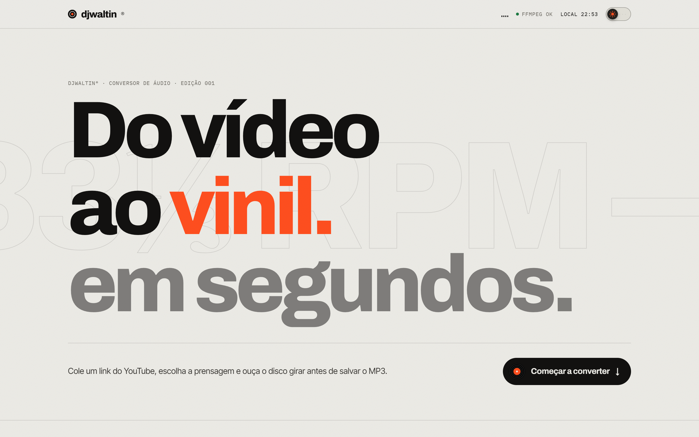
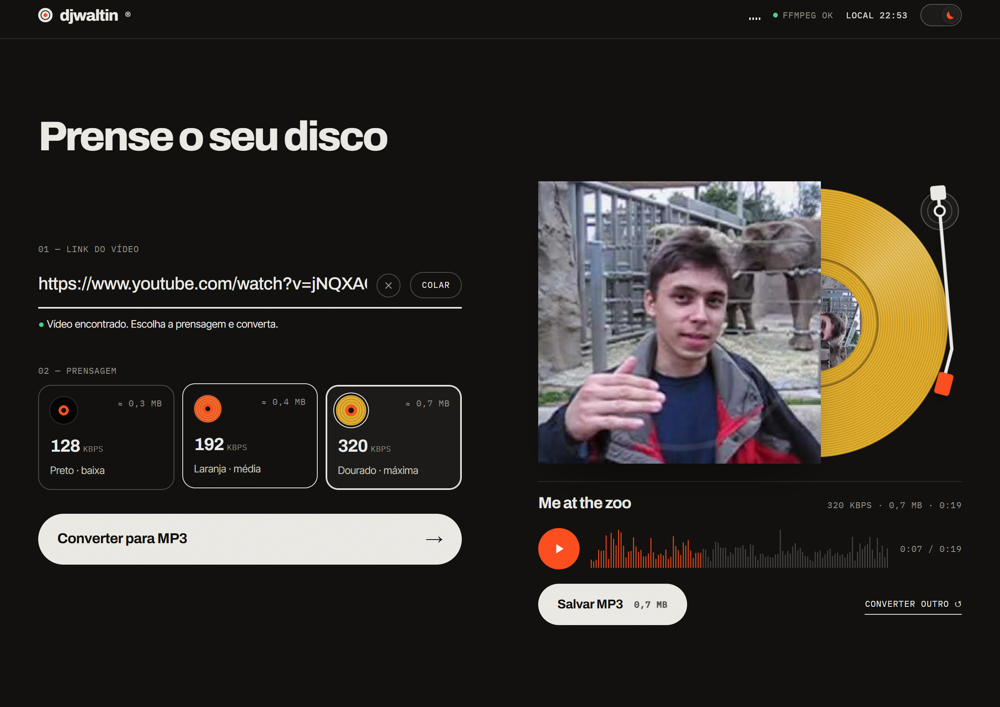
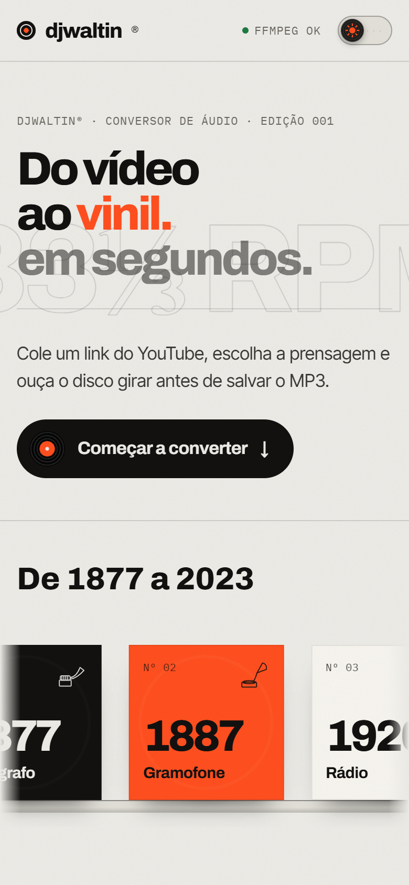
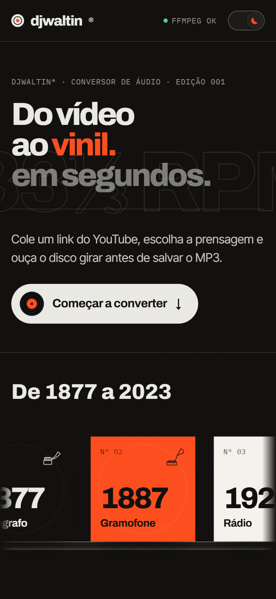
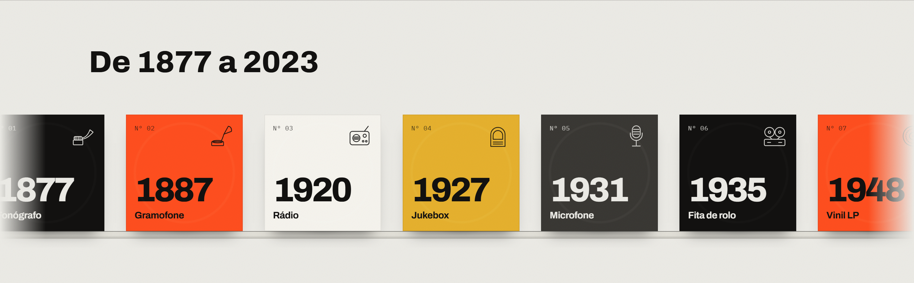
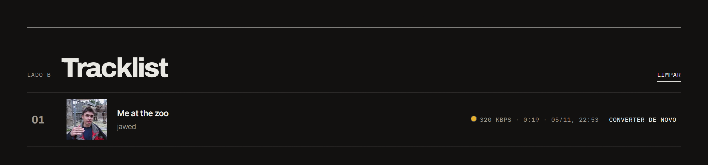

# DJWaltin - YouTube to MP3 Downloader 🎵

A simple web application to download YouTube videos and convert them directly to MP3 audio files. 

## 📸 Screenshots





<p align="center">
  
  &nbsp;&nbsp;
  
</p>






## 🚀 How to Run

### 1. Install Dependencies (First time only)
```bash
pip install -r requirements.txt
```
### 2. Start the server
```bash
python app.py
```

### 3. Open in Your Browser
Go to: http://localhost:5000

### 4. Download
Paste the YouTube link.

Choose the quality.

Click "Converter para MP3".

💡 Note on files: The app doesn't clutter your project folder. It processes everything in a temporary system directory and streams the MP3 straight to your browser. After you save it, the file stays available for 2 more minutes (so the in-page player keeps working) and is then deleted. Converted files that are never saved are deleted after 30 minutes.

### Interface
Paste a link (or use the **COLAR** button) and the app shows a preview of the video (cover, title, channel, duration) plus the estimated MP3 size for each quality. During conversion it shows each step (connecting, downloading, converting, done). When it's ready you can listen to the MP3 with a waveform player before saving it. Recent conversions are listed below the panel, stored only in your browser.

---

### 5. Stop the Server
Press Ctrl + C in your terminal.

Pro Tip: Choose Where to Save
If your browser automatically downloads files to your default folder and you want it to ask you where to save the MP3 every time, change this setting:

Chrome / Edge: Settings > Downloads > Toggle on "Ask where to save each file before downloading"
Firefox: Settings > General > Downloads > Select "Always ask you where to save files"

## 🗂️ Project Structure

```
app.py                  HTTP routes only (Flask)
converter/
  config.py             temp folder, allowed qualities, cleanup timings
  jobs.py               Job dataclass + in-memory repository with timed cleanup
  youtube.py            yt-dlp wrapper: video metadata, MP3 download, friendly errors
  conversion.py         runs a conversion in a background thread and updates the Job
templates/
  Index.html            page skeleton + list of stylesheets
  partials/             one Jinja partial per section (Header, Hero, Shelf, Converter, Tracklist, Footer)
static/css/             one file per section, loaded in cascade order (Tokens first, Responsive/Motion last)
static/js/
  App.js                entry point: wires the components together
  lib/                  Dom (`ui` element lookup), Api client, Format, YouTube link check
  components/           Turntable, LinkField, Steps, Player, Tracklist, Toasts, ThemeToggle, Decorations
tests/                  backend tests (yt-dlp is mocked, no network needed)
```

Conventions:

- Front-end files (JS, CSS, templates) use PascalCase; Python modules stay lowercase (PEP 8).
- Code identifiers (variables, functions, classes, files) are in English. Comments and docstrings are in Portuguese, and so is what users see (interface text, error messages) and the data: API routes and JSON fields (`/api/baixar`, `qualidade`, `erro`, job status values) and the history stored in the browser.
- The screenshots above live in `docs/screenshots/`.
- Interface texts that belong to the markup (step descriptions, the busy button label) live in the HTML as `data-*` attributes, not in JavaScript constants.

## ✅ Tests

```bash
python -m unittest
```

📌 Important Notes
FFmpeg Required: Make sure FFmpeg is installed and configured in your system's environment variables.
Local Only: The server runs strictly on your localhost. It is completely private and inaccessible from the outside.
Disclaimer: Use this tool responsibly and only download content you have the rights to.
